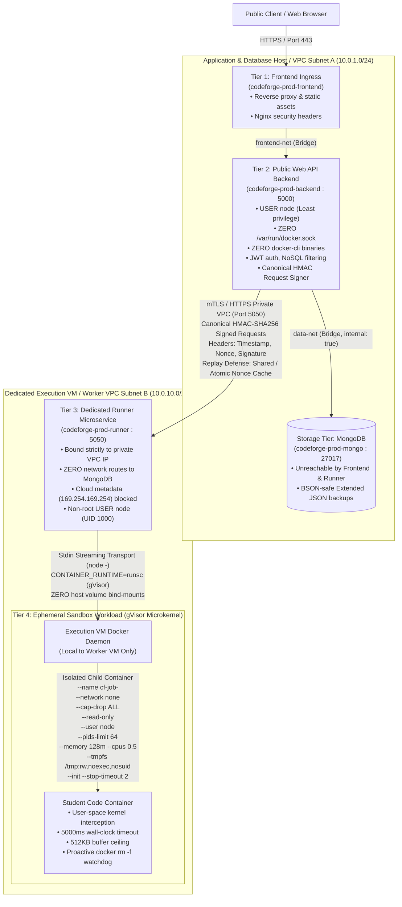

# CodeForge — Production Isolated Code Runner Architecture (REM-P0-03)

**Document Version:** 3.0.0  
**Classification:** Application Security Architecture Specification  
**Status:** Architecture Specified & Implemented; Multi-Host Infrastructure Deployment Gated  
**Date:** 2026-10-15  

---

## 1. Overview & Problem Statement

In single-host Docker Compose environments, mounting `/var/run/docker.sock` into any container grants root-equivalent control over the host Docker daemon. In REM-P0-01, the Docker socket and Docker CLI tools were stripped from the public-facing Node.js backend container (`codeforge-backend`). In REM-P0-02, network microsegmentation, stdin streaming transport, canonical HMAC-SHA256 signing, and active termination watchdogs were implemented.

However, in single-host deployments, the dedicated runner container (`codeforge-runner`) still mounts `/var/run/docker.sock`. If the runner process itself were compromised (e.g. via an Express zero-day, unauthenticated RPC exposure, or internal SSRF), an attacker could issue Docker commands to escape the container and achieve complete host takeover.

**REM-P0-03 defines the production multi-host execution architecture that eliminates this host-compromise blast radius.**

---

## 2. Multi-Host 4-Tier Trust Boundary Architecture



---

## 3. Trust Boundary & Blast Radius Analysis

| Breach Scenario | Compromised Component | Blast Radius & Attacker Capabilities | Containment Mechanism |
|---|---|---|---|
| **Scenario 1:** Public API Web Vulnerability | `codeforge-backend` container | Attacker achieves RCE inside the Express API container. | **Strictly Contained:** Backend has ZERO Docker socket mounts and NO `docker-cli`. Cannot spawn containers. Cannot access runner socket. Can only send signed requests to runner API, which strictly validates source code payloads and limits execution to isolated sandbox containers. |
| **Scenario 2:** Runner Microservice Compromise | `codeforge-runner` container on Worker VM | Attacker achieves RCE inside the runner daemon on the Dedicated Execution VM. | **Contained to Worker VM:** Because the runner is deployed on a dedicated VM in Subnet B, the attacker can only interact with the Worker VM's local Docker daemon. The attacker **CANNOT** reach the application host, MongoDB database, customer credentials, or cloud metadata. The Worker VM is disposable and stateless. |
| **Scenario 3:** Student Code Container Escape | Ephemeral Sandbox (`node:20-alpine`) | Untrusted student submission attempts kernel exploit or filesystem traversal. | **Double-Layer Containment:**<br>1. Ephemeral container flags (`--network none`, `--cap-drop ALL`, `--read-only`, `--user node`, `--pids-limit 64`, memory 128MB, CPU 0.5).<br>2. gVisor (`runsc`) user-space microkernel intercepts all syscalls, neutralizing Linux kernel privilege escalation exploits.<br>3. Zero host filesystems are mounted (stdin streaming transport). |
| **Scenario 4:** Request Replay / Man-in-the-Middle | Intercepted internal network traffic | Attacker eavesdrops on internal VPC packets between Backend and Runner. | **Cryptographically Defeated:** Requests require canonical HMAC-SHA256 signatures covering method, canonical path, timestamp, nonce, and request body hash. Nonces are cached with a 120s TTL and strictly rejected upon duplicate receipt (401 `REPLAYED_REQUEST_NONCE`). Timestamps older than 60s are rejected (401 `EXPIRED_REQUEST_TIMESTAMP`). |

---

## 4. Network Microsegmentation & Traffic Matrix

| Source Service | Destination Service | Port / Protocol | Allowed? | Enforcement Layer | Justification |
|---|---|---|---|---|---|
| Public Internet | `frontend` | 80, 443 (HTTP/S) | **YES** | Host firewall / Load balancer | Public web ingress |
| Public Internet | `backend` | 5000 | **NO** | `ports` omitted, internal bridge | Backend only accessed via reverse proxy |
| Public Internet | `mongodb` | 27017 | **NO** | `data-net` (`internal: true`) | Database never published |
| Public Internet | `runner` | 5050 | **NO** | `ports` bound to `127.0.0.1` / VPC IP | Runner strictly internal |
| `frontend` | `backend` | 5000 (HTTP) | **YES** | `frontend-net` | Reverse proxy routing to API |
| `frontend` | `mongodb` | 27017 | **NO** | Network isolation (no route) | Frontend has zero DB access |
| `frontend` | `runner` | 5050 | **NO** | Network isolation (no route) | Frontend has zero runner access |
| `backend` | `mongodb` | 27017 (TCP) | **YES** | `data-net` | Mongoose database queries |
| `backend` | `runner` | 5050 (HTTP/mTLS)| **YES** | `runner-net` / VPC Subnet B | Authenticated execution dispatch |
| `runner` | `mongodb` | 27017 | **NO** | Network isolation / VPC firewall | Runner has zero DB access |
| `runner` | `backend` | 5000 | **NO** | Firewall / No reverse route | Runner cannot initiate requests to backend |
| `runner` | Public Internet | ANY | **NO** | `internal: true` / VPC egress drop | Outbound WAN disabled |
| `runner` | Cloud Metadata | 169.254.169.254 | **NO** | iptables drop rule on Worker VM | Prevents IAM role credential theft |
| Ephemeral Sandbox | ANY Network | ANY | **NO** | `--network none` | Air-gapped container execution |

---

## 5. Request Authentication & Replay Defense Protocol

Every HTTP request from the backend to the runner microservice is signed using AWS SigV4-style canonical request signing:

### 5.1 Canonical Request Format
```
METHOD
PATH
TIMESTAMP
NONCE
BODY_SHA256_HEX
```

### 5.2 Required Headers
1. `X-CodeForge-Timestamp`: Millisecond epoch timestamp (`Date.now().toString()`).
2. `X-CodeForge-Nonce`: 32-character random hex string (`UUID + randomBytes(8)`).
3. `X-CodeForge-Signature`: HMAC-SHA256 digest of canonical request using `RUNNER_SHARED_SECRET`.
4. `X-Runner-Secret`: Primary secret header (verified in constant time).

### 5.3 Verification Algorithm
1. **Header Validation:** Confirm all 4 headers are present.
2. **Timestamp Freshness:** Ensure $|t_{\text{req}} - t_{\text{now}}| \le 60{,}000\text{ ms}$. Reject if expired or in the future (`EXPIRED_REQUEST_TIMESTAMP`).
3. **Nonce Format:** Strictly enforce alphanumeric string of 16–128 characters (`INVALID_NONCE_FORMAT`).
4. **Signature Format:** Strictly enforce 64-character lowercase hex string (`INVALID_SIGNATURE_FORMAT`).
5. **Constant-Time Verification:** Recompute expected HMAC-SHA256 over canonical string and compare using `crypto.timingSafeEqual` over 32-byte buffers.
6. **Atomic Nonce Claim:** Check and insert nonce in the active NonceStore. If already seen, reject with 401 `REPLAYED_REQUEST_NONCE`.

### 5.4 Multi-Replica Nonce Store Considerations
- In single-replica development/staging, `InMemoryNonceStore` provides fast in-process replay protection.
- In multi-replica production environments, the runner microservice must configure `SharedNonceStore` backed by Redis (`SET key 1 EX 120 NX`) or MongoDB with TTL index, ensuring that a nonce submitted to Replica 1 cannot be replayed against Replica 2.

---

## 6. Execution Lifecycle & Watchdog Enforcement

1. **Stdin Streaming Transport:** Untrusted code and test input are assembled into a single in-memory JavaScript string (`buildStdinExecutionBundle`) and piped to `docker run -i ... node:20-alpine node -`. No host disk files or directories are created or mounted.
2. **Deterministic Naming:** Every container is named `--name cf-job-<uuid>`.
3. **Signal Forwarding:** Spawns with `--init` and `--stop-timeout 2`.
4. **Active Process & Engine Watchdog:** If execution exceeds 5000ms wall-clock time or 512KB process buffer ceiling, the runner invokes `killExecutionContainer()`, which runs `docker rm -f <containerName>` directly against the Docker daemon, guaranteeing destruction even if the process was hung in uninterruptible system calls.
5. **Graceful Daemon Shutdown:** `SIGTERM` and `SIGINT` handlers iterate all active jobs and forcefully clean up orphan containers before process exit.

---

## 7. Mandatory Prerequisites for Public Production "GO"

To transition from **NO-GO** to **GO for Public Multi-Tenant Production**, the following infrastructure prerequisites must be physically deployed and verified:

1. **Physical Host Separation:** Deploy `docker-compose.prod.app.yml` on Host 1 and `docker-compose.prod.runner.yml` on Host 2 in separate VPC subnets with strictly firewall-controlled ingress.
2. **gVisor / MicroVM Runtime:** Verify that the execution host runs Docker with `--runtime=runsc` or Firecracker microVMs.
3. **Live Sandbox Verification:** Verify active container runtime execution, memory limit enforcement, CPU quota throttling, and air-gapped packet dropping against an active container daemon.
